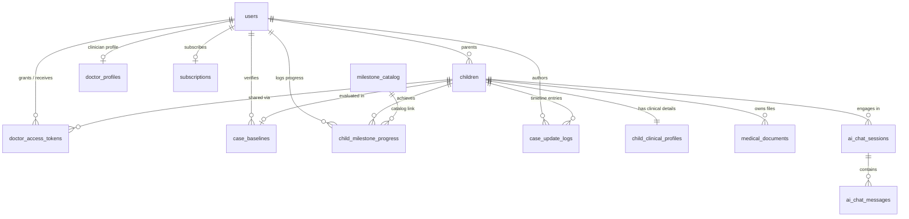
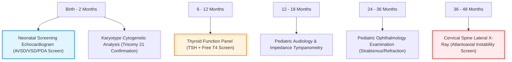
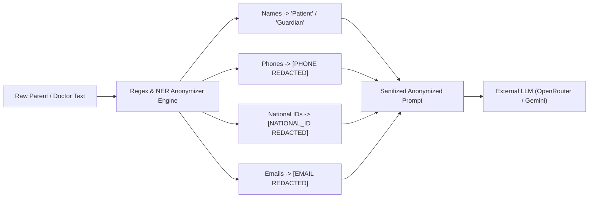
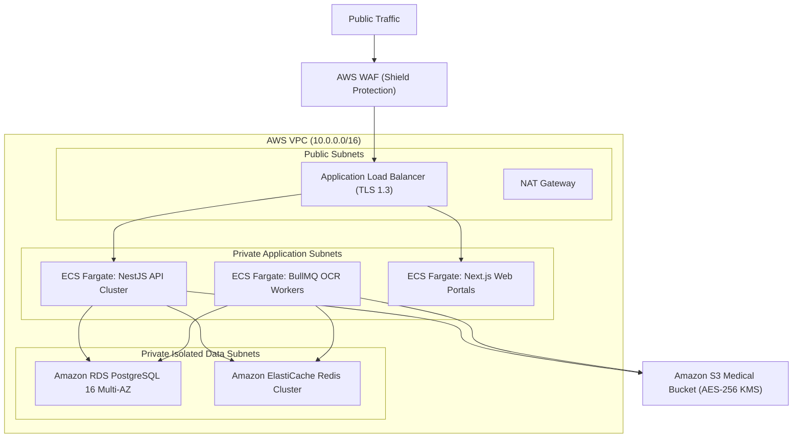

# Down Plus — Digital Health Engine
## Comprehensive Technical Architecture & System Specification Document (TDD / SDS)

**Document Version:** 2.0.0  
**Status:** Approved for Client & Engineering Review  
**Confidentiality:** Proprietary & Confidential  
**Solution Delivery Partners:** Medexia.ai (Clinical Architecture) & AI MicroMind (AI & Engineering)  
**Classification:** Digital Health Software Architecture (Pediatric & Special Needs)  

---

## Table of Contents
1. [Executive Summary & Clinical Mission](#1-executive-summary--clinical-mission)
2. [End-to-End System Architecture](#2-end-to-end-system-architecture)
   - 2.1 Multi-Tenant Core vs. Disease-Specific Modules
   - 2.2 System Topology (C4 Level 2 Container Diagram)
   - 2.3 Component Stack & Responsibilities
3. [Complete Database Architecture & Data Dictionary](#3-complete-database-architecture--data-dictionary)
   - 3.1 Entity-Relationship Diagram (ERD)
   - 3.2 Data Models, Enums & Relations
   - 3.3 Vector & Clinical Knowledge Storage (`pgvector`)
4. [Clinical Domain & Intelligent Health Engine](#4-clinical-domain--intelligent-health-engine)
   - 4.1 AAP Health Supervision Guidelines Matrix
   - 4.2 The 4-Stage Independence Ladder
   - 4.3 Multi-Factor Specialist Matching Algorithm
   - 4.4 Life Passport & Emergency QR Engine
5. [Security, Privacy & Regulatory Compliance (HIPAA / GDPR)](#5-security-privacy--regulatory-compliance-hipaa--gdpr)
   - 5.1 Strict PII Isolation
   - 5.2 Deterministic AI Anonymization Boundary (`AnonymizerService`)
   - 5.3 Cryptography, Storage & Ephemeral Presigned URLs
   - 5.4 Role-Based Access Control (RBAC) Matrix
6. [API Interface & Subsystem Specifications](#6-api-interface--subsystem-specifications)
7. [Infrastructure, Cloud Deployment & DevOps](#7-infrastructure-cloud-deployment--devops)
   - 7.1 Local Development Stack (Docker Compose)
   - 7.2 AWS Production Infrastructure (Terraform IaC)
   - 7.3 High Availability, Backup & Disaster Recovery

---

## 1. Executive Summary & Product Vision

**Down Plus** is an enterprise-grade pediatric digital health platform designed to transform the developmental care continuum for children with Down Syndrome (Trisomy 21). The platform bridges the fragmented ecosystem between parents, pediatric specialists (neurologists, cardiologists, endocrinologists, speech pathologists, and occupational therapists), and specialized care clinics.

### Core Objectives
1. **Clinical Supervision Compliance:** Operationalize the **American Academy of Pediatrics (AAP)** Health Supervision Guidelines into automated, timely clinical milestones and screenings (e.g., congenital heart screening via echocardiogram, thyroid panels, atlantoaxial cervical spine evaluations).
2. **Developmental Progression Tracking:** Implement the **Independence Ladder** to track developmental achievements across fine motor, gross motor, cognitive, speech, and self-care domains.
3. **AI Clinical Assistant with Zero-PII Leakage:** Provide an AI-powered conversational assistant that grounds answers in verified pediatric guidelines while guaranteeing zero Personally Identifiable Information (PII) leaves the secure boundary.
4. **Instant Interoperability:** Provide a **Life Passport**—a single-source digital health record accessible via cryptographically signed, expiring QR codes for emergency medical staff and consulting clinicians.
5. **Multi-Tenant Foundation:** Built on a decoupled core engine capable of scaling into adjacent developmental disorders (e.g., Cerebral Palsy, Autism Spectrum Disorder, ADHD) without core re-architecture.

---

## 2. End-to-End System Architecture

### 2.1 Multi-Tenant Core vs. Disease-Specific Modules

The architecture strictly decouples generic digital health infrastructure (**Core Engine**) from clinical disease models (**Disease Modules**):

```
┌──────────────────────────────────────────────────────────────────────────────────────────────┐
│                                 Digital Health Core Engine                                   │
│  - Identity, JWT Auth & RBAC (Parent, Doctor, Clinic Admin, Super Admin)                     │
│  - Child & Family Graph Management                                                           │
│  - Encrypted Document Vault (S3 / MinIO + Presigned Access)                                   │
│  - AI Anonymization Boundary & Gateway Abstraction                                           │
│  - Payment Gateway Orchestration (Paymob Subscriptions & Webhooks)                          │
│  - Ephemeral Sharing Bus & QR Cryptographic Token Service                                    │
│  - Push Notification & SMS Alert Engine                                                      │
└──────────────────────────────────────────────┬───────────────────────────────────────────────┘
                                               │
                       ┌───────────────────────┴───────────────────────┐
                       ▼                                               ▼
     ┌───────────────────────────────────┐           ┌───────────────────────────────────┐
     │   Down Plus Module (Active v1)    │           │ Future Modules (CP, ASD, ADHD)    │
     │ - AAP Down Syndrome Screening     │           │ - GMFCS Motor Evaluation Matrix   │
     │ - 4-Stage Independence Matrix     │           │ - Sensory Integration Trackers    │
     │ - Trisomy 21 Doctor Weighting     │           │ - DSM-5 / ICD-11 Diagnostic Trees │
     │ - Down Karyotype Classification   │           │ - Customized Rehabilitation Plans │
     └───────────────────────────────────┘           └───────────────────────────────────┘
```

All domain-specific tables (such as `MilestoneCatalog` and `ClinicalKnowledgeVector`) feature a `module_disease` discriminator column defaulting to `'Down Syndrome'`.

---

### 2.2 System Topology (C4 Level 2 Container Diagram)

```
                            ┌────────────────────────────────────────┐
                            │            CLIENT CLIENTS              │
                            └────┬──────────────────────────────┬────┘
                                 │                              │
                     HTTPS / TLS 1.3                HTTPS / TLS 1.3
                                 │                              │
                                 ▼                              ▼
    ┌─────────────────────────────────────────┐  ┌──────────────────────────────────────────┐
    │     Mobile Application (React Native)    │  │       Doctor & Admin Web Portal          │
    │  - Expo SDK 51 / React Native 0.74      │  │  - Next.js 14 (App Router) + Tailwind     │
    │  - Offline-first cache & Secure Store   │  │  - Doctor Clinical Dashboard & Baseline  │
    │  - QR Scanner & Life Passport View      │  │  - External Temporary Access Viewer       │
    │  - Real-time AI Health Chatbot          │  │  - Admin Governance & User Management    │
    └────────────────────┬────────────────────┘  └────────────────────┬─────────────────────┘
                         │                                            │
                         └──────────────────────┬─────────────────────┘
                                                │ RESTful JSON API
                                                ▼
                        ┌─────────────────────────────────────────────┐
                        │          NestJS Backend API Gateway         │
                        │  - Modular Architecture (TypeScript)        │
                        │  - JWT + Passport Auth Guards & RBAC        │
                        │  - Rate Limiting (Throttler)                │
                        │  - Anonymizer Service (PII Scrubber)        │
                        │  - Swagger / OpenAPI Contract               │
                        └──────┬──────────────┬───────────────┬───────┘
                               │              │               │
            ┌──────────────────┘              │               └──────────────────┐
            ▼                                 ▼                                  ▼
┌───────────────────────┐         ┌───────────────────────┐          ┌───────────────────────┐
│ Primary Database      │         │ Cache & Job Broker    │          │ Cloud Object Storage  │
│ PostgreSQL 16 +       │         │ Redis 7               │          │ AWS S3 / MinIO        │
│ pgvector + pgcrypto   │         │ - Session Caching     │          │ - AES-256 Encrypted   │
│ - Relational records  │         │ - BullMQ Queues       │          │ - Presigned Upload    │
│ - Embeddings storage  │         │ - Rate limiting state │          │ - Presigned Download  │
└───────────────────────┘         └───────────┬───────────┘          └───────────────────────┘
                                              │
                                              ▼
                                  ┌───────────────────────┐
                                  │ Background OCR &      │
                                  │ Analysis Workers      │
                                  │ - BullMQ Worker       │
                                  │ - Tesseract / OCR     │
                                  │ - Medical Doc Parser  │
                                  └───────────┬───────────┘
                                              │
                                              ▼
                                  ┌───────────────────────┐
                                  │ AI & External Gateways│
                                  │ - OpenRouter / Gemini │
                                  │ - Paymob Payments API │
                                  │ - Twilio / Firebase   │
                                  └───────────────────────┘
```

---

### 2.3 Component Stack & Responsibilities

| Layer | Selected Technology | Version | Key Architectural Responsibility |
|---|---|---|---|
| **API Gateway / Backend** | NestJS / Express | 10.x | Enterprise application framework, dependency injection, guard-based RBAC, input validation via class-validator/Zod. |
| **Object-Relational Mapping** | Prisma ORM | 5.x | Type-safe database queries, schema migrations, automatic connection pooling, and multi-tenant schema isolation. |
| **Relational & Vector DB** | PostgreSQL + `pgvector` | 16.x | System of record. Houses relational schemas, JSONB clinical summaries, and high-dimensional clinical vector embeddings for semantic RAG. |
| **Job Queue & Caching** | Redis + BullMQ | 7.x | Decouples CPU-intensive tasks (PDF document OCR parsing, embedding generation, push notifications) from synchronous HTTP threads. |
| **Mobile Client** | React Native (Expo) | 51 / 0.74 | Cross-platform (iOS & Android) mobile application for parents. Offline state management, biometric auth, camera upload, and interactive chat. |
| **Web Portal** | Next.js (App Router) | 14.x | Clinician dashboard, case baseline verification workbench, QR guest portal, and platform administrative operations. |
| **Storage Engine** | AWS S3 / MinIO | S3 API | Secure, encrypted blob storage for patient medical reports, imaging, laboratory results, and exported Life Passports. |
| **AI LLM Gateway** | OpenRouter (Gemini / Claude) | Unified API | Clinical reasoning, document summarization, milestone recommendations, and symptom triaging via strictly anonymized prompt templates. |
| **Billing & Payments** | Paymob Integration | v1/v2 API | Regional payment processor supporting Cards, Mobile Wallets (Vodafone Cash, Orange, Etisalat), and Fawry kiosks. |

---

## 3. Complete Database Architecture & Data Dictionary

### 3.1 Entity-Relationship Diagram (ERD)



---

### 3.2 Data Models, Enums & Relations

#### Enums
- **`user_role`**: `parent`, `doctor`, `clinic_admin`, `super_admin`
- **`document_status`**: `uploaded`, `processing_ocr`, `ocr_completed`, `failed`
- **`baseline_status`**: `draft_pending_doctor`, `confirmed_by_doctor`, `manually_overridden`
- **`skill_status`**: `not_started`, `with_assistance`, `independent`, `mastered_outside`
- **`subscription_tier`**: `free`, `premium_monthly`, `premium_annual`
- **`subscription_status`**: `active`, `canceled`, `past_due`, `expired`

#### Table Specifications

##### 1. `users`
| Column | Type | Constraints | Description |
|---|---|---|---|
| `id` | UUID | PK, `default(uuid_generate_v4())` | Primary key identifier |
| `email` | VARCHAR(255) | UNIQUE, NOT NULL | User email address |
| `phone_number` | VARCHAR(30) | UNIQUE, NOT NULL | International format mobile number |
| `password_hash` | VARCHAR(255) | NOT NULL | Argon2id / bcrypt salted hash |
| `role` | `user_role` | NOT NULL, DEFAULT `'parent'` | Security role |
| `is_verified` | BOOLEAN | DEFAULT `false` | Mobile OTP / email verification flag |
| `created_at` | TIMESTAMPTZ | DEFAULT `now()` | Timestamp of record creation |
| `updated_at` | TIMESTAMPTZ | DEFAULT `now()`, auto-update | Timestamp of last modification |

##### 2. `children`
| Column | Type | Constraints | Description |
|---|---|---|---|
| `id` | UUID | PK, `default(uuid_generate_v4())` | Child unique identifier |
| `parent_id` | UUID | FK -> `users(id)`, ON DELETE CASCADE | Guardian reference |
| `first_name` | VARCHAR(100) | NOT NULL | Given name (isolated PII) |
| `last_name` | VARCHAR(100) | NOT NULL | Family name (isolated PII) |
| `date_of_birth` | DATE | NOT NULL | Used for AAP age calculation |
| `gender` | VARCHAR(10) | NULLABLE | Biological sex (`male`, `female`) |
| `blood_type` | VARCHAR(5) | NULLABLE | ABO & Rh factor (e.g., `A+`, `O-`) |
| `avatar_url` | TEXT | NULLABLE | Secure S3 profile avatar |
| `created_at` | TIMESTAMPTZ | DEFAULT `now()` | Registration timestamp |

##### 3. `child_clinical_profiles`
| Column | Type | Constraints | Description |
|---|---|---|---|
| `id` | UUID | PK, `default(uuid_generate_v4())` | Clinical profile ID |
| `child_id` | UUID | UNIQUE, FK -> `children(id)`, CASCADE | 1:1 Child relationship |
| `primary_diagnosis` | VARCHAR(100) | DEFAULT `'Down Syndrome'` | Disease module discriminator |
| `karyotype_type` | VARCHAR(100) | NULLABLE | Free Trisomy 21 (95%), Translocation, Mosaicism |
| `gestational_age_weeks` | INT | NULLABLE | Pre-term / full-term age (e.g. 36) |
| `birth_weight_kg` | DECIMAL(4,2) | NULLABLE | Birth weight in kilograms |
| `comorbidities` | JSONB | DEFAULT `'[]'` | List of conditions (e.g., AVSD, Hypothyroidism) |
| `created_at` / `updated_at` | TIMESTAMPTZ | Audit timestamps | Audit track |

##### 4. `medical_documents`
| Column | Type | Constraints | Description |
|---|---|---|---|
| `id` | UUID | PK, `default(uuid_generate_v4())` | Document unique ID |
| `child_id` | UUID | FK -> `children(id)`, CASCADE | Child reference |
| `file_name` | VARCHAR(255) | NOT NULL | Original sanitized file name |
| `s3_key` | TEXT | NOT NULL | S3 storage key path |
| `file_type` | VARCHAR(50) | NOT NULL | MIME type (e.g. `application/pdf`, `image/png`) |
| `document_category` | VARCHAR(50) | NOT NULL | `Echo`, `Lab`, `Genetics`, `Therapy_Report`, `Prescription` |
| `ocr_raw_text` | TEXT | NULLABLE | Extracted text from background OCR pipeline |
| `processing_status` | `document_status` | DEFAULT `'uploaded'` | Ingestion lifecycle state |
| `uploaded_at` | TIMESTAMPTZ | DEFAULT `now()` | Upload timestamp |

##### 5. `case_baselines`
| Column | Type | Constraints | Description |
|---|---|---|---|
| `id` | UUID | PK, `default(uuid_generate_v4())` | Baseline assessment ID |
| `child_id` | UUID | UNIQUE, FK -> `children(id)`, CASCADE | Child reference |
| `ai_generated_summary`| JSONB | NOT NULL | Extracted clinical state, risks, and next steps |
| `doctor_notes` | TEXT | NULLABLE | Verified clinical notes and amendments |
| `status` | `baseline_status` | DEFAULT `'draft_pending_doctor'` | State of medical verification |
| `verified_by_doctor_id`| UUID | NULLABLE, FK -> `users(id)` | Doctor who validated the baseline |
| `verified_at` | TIMESTAMPTZ | NULLABLE | Verification timestamp |

##### 6. `milestone_catalog`
| Column | Type | Constraints | Description |
|---|---|---|---|
| `id` | UUID | PK, `default(uuid_generate_v4())` | Milestone catalog ID |
| `module_disease` | VARCHAR(50) | DEFAULT `'Down Syndrome'` | Disease partition identifier |
| `domain` | VARCHAR(50) | NOT NULL | `motor`, `speech`, `cognitive`, `independence`, `medical` |
| `age_bracket_min_months`| INT | NOT NULL | Lower boundary in months |
| `age_bracket_max_months`| INT | NOT NULL | Upper developmental window in months |
| `title_ar` / `title_en` | VARCHAR(255) | NOT NULL | Localized skill title (Arabic & English) |
| `description_ar` / `en` | TEXT | NULLABLE | Detailed rubric descriptions |
| `is_mandatory_clinical_check` | BOOLEAN | DEFAULT `false` | True if mandatory AAP medical screening |

##### 7. `child_milestone_progress`
| Column | Type | Constraints | Description |
|---|---|---|---|
| `id` | UUID | PK, `default(uuid_generate_v4())` | Progress entry ID |
| `child_id` | UUID | FK -> `children(id)`, CASCADE | Child reference |
| `milestone_id` | UUID | FK -> `milestone_catalog(id)`, RESTRICT| Milestone catalog reference |
| `status` | `skill_status` | DEFAULT `'not_started'` | Progression state |
| `last_updated_by_user_id`| UUID | FK -> `users(id)` | User who recorded the status |
| `notes` | TEXT | NULLABLE | Parent or therapist field observations |
| `updated_at` | TIMESTAMPTZ | DEFAULT `now()`, auto-update | Last status update |
| **Unique Constraint** | `[child_id, milestone_id]` | UNIQUE | Prevents duplicate progress rows per skill |

##### 8. `doctor_profiles`
| Column | Type | Constraints | Description |
|---|---|---|---|
| `id` | UUID | PK, `default(uuid_generate_v4())` | Doctor profile ID |
| `user_id` | UUID | UNIQUE, FK -> `users(id)`, CASCADE | Linked authenticated user |
| `full_name` | VARCHAR(255) | NOT NULL | Clinician professional name |
| `medical_license_number`| VARCHAR(100) | NOT NULL | Verified syndicate license |
| `specialty` | VARCHAR(100) | NOT NULL | e.g., Pediatric Neurology, Cardiology, Speech Therapy |
| `city` / `governorate` | VARCHAR(100) | NOT NULL | Geographic operational region |
| `consultation_fee` | DECIMAL(10,2) | NOT NULL | Clinic consultation fee |
| `experience_years_pediatric`| INT | NOT NULL | Total years practicing pediatrics |
| `down_syndrome_experience_score`| DECIMAL(3,2)| DEFAULT `5.00` | Normalized experience rating (0.00 – 10.00) |
| `tags` | TEXT[] | NOT NULL | Clinical tags (`["Trisomy21", "SpeechDelay", "AVSD"]`) |
| `is_active` | BOOLEAN | DEFAULT `true` | Listing status in matching engine |

##### 9. `doctor_access_tokens`
| Column | Type | Constraints | Description |
|---|---|---|---|
| `id` | UUID | PK, `default(uuid_generate_v4())` | Token record ID |
| `child_id` | UUID | FK -> `children(id)`, CASCADE | Child record being accessed |
| `granted_by_user_id` | UUID | FK -> `users(id)` | Parent granting access |
| `target_doctor_id` | UUID | NULLABLE, FK -> `users(id)` | Doctor assigned, or null for emergency QR |
| `token` | VARCHAR(128) | UNIQUE, NOT NULL | High-entropy crypto URL token |
| `can_view_full_history` | BOOLEAN | DEFAULT `true` | Permission flag: view history |
| `can_add_clinical_notes`| BOOLEAN | DEFAULT `false` | Permission flag: append notes |
| `expires_at` | TIMESTAMPTZ | NOT NULL | Enforced expiration (e.g. 24h / 48h) |

##### 10. `ai_chat_sessions` & `ai_chat_messages`
- Manages parent conversational encounters.
- `ai_chat_messages` records `sender_type` (`parent`, `assistant`), message content, and an array of `recommended_doctor_ids` generated when clinical escalation is indicated.

##### 11. `clinical_knowledge_vectors`
- Stores chunked medical literature, AAP guidelines, and protocol summaries.
- Leverages the PostgreSQL `pgvector` extension for cosine distance search (`<=>`).

##### 12. `subscriptions`
- Binds parents to billing tiers (`free`, `premium_monthly`, `premium_annual`).
- Tracks Paymob transactions, payment statuses, and recurring renewal dates.

---

## 4. Clinical Domain & Intelligent Health Engine

### 4.1 AAP Health Supervision Guidelines Matrix

The platform integrates the **American Academy of Pediatrics (AAP) Health Supervision Schedule for Children with Down Syndrome**, translating static clinical manuals into active, automated screening triggers:



*When a child's birth date enters a guideline window, the system automatically marks the screening as a high-priority mandatory clinical check, surfacing alerts on the parent mobile home screen and doctor baseline evaluation workbench.*

---

### 4.2 The 4-Stage Independence Ladder

Rather than binary completion (yes/no), Down Plus implements a granular four-stage developmental ladder tailored to developmental delays and therapeutic progression:

```
[ 1. not_started ] ──► [ 2. with_assistance ] ──► [ 3. independent ] ──► [ 4. mastered_outside ]
  (Initial Baseline)      (Guided Execution)         (Home Mastery)          (Full Generalization)
```

1. **`not_started` (Initial Baseline):** The child cannot initiate or perform the skill.
2. **`with_assistance` (Guided Execution):** The child performs the task with verbal/physical prompts or adaptive devices (e.g., SMO ankle orthotics, specialized spoons).
3. **`independent` (Home Mastery):** The child executes the milestone independently within standard home environments.
4. **`mastered_outside` (Full Generalization):** Generalization achieved across multiple external settings (school, nursery, clinic, playground) without regression.

---

### 4.3 Multi-Factor Specialist Matching Algorithm

When an AI conversation or clinical baseline identifies a specialist requirement (e.g., congenital cardiac repair, thyroid regulation, articulation delay), the matching engine executes a deterministic scoring formula:

$$\text{Composite Score} = (S \times 0.40) + (L \times 0.25) + (E \times 0.20) + (R \times 0.15)$$

Where:
- **$S$ (Specialty Match — 40%):** Exact match score (1.0 or 0.0) between recommended sub-specialty (e.g., *Pediatric Speech Pathology*) and the doctor's primary specialty.
- **$L$ (Location Proximity — 25%):** Geographic proximity match: 1.0 for exact city/governorate match (e.g., *Giza, Cairo*), 0.5 for adjacent governorates, 0.0 otherwise.
- **$E$ (Down Syndrome Experience — 20%):** Normalized clinical experience score calculated from verified Trisomy 21 case history:
  $$\min\left(1.0, \frac{\text{Down Experience Score}}{10.0}\right)$$
- **$R$ (Seniority & Rating — 15%):** Normalized metric based on pediatric clinical practice years:
  $$\min\left(1.0, \frac{\text{Years of Pediatric Experience}}{20.0}\right)$$

Doctors with scores $\ge 0.70$ are dynamically prioritized and rendered as interactive doctor consultation cards in both the mobile chat interface and parent directory.

---

### 4.4 Life Passport & Emergency QR Engine

The **Life Passport** condenses extensive medical histories into a high-utility, tamper-resistant digital document:
- **Dynamic Content:** Active diagnoses, verified karyotype, critical comorbidities (e.g. cardiac status, AAI precautions), current medications with dosages, allergies, and achieved milestones.
- **Cryptographic Ephemeral QR:** Generates a secure, 128-character signed URL token with configurable time-to-live (e.g., 24h, 48h).
- **Zero App Requirement for Doctors:** Emergency personnel or new consulting physicians scan the QR code to open a read-only, authenticated Next.js guest portal view without requiring account creation.
- **Audit Logging:** Every scan or access event logs IP address, timestamp, and user agent to the child's `case_update_logs`.

---

## 5. Security, Privacy & Regulatory Compliance (HIPAA / GDPR)

### 5.1 Strict PII Isolation
Personally Identifiable Information (`first_name`, `last_name`, `phone_number`, `email`, Egyptian National ID) is stored exclusively in the `users` and `children` tables. Downstream analytics, AI prompt injections, and vector embeddings operate exclusively on anonymized identifiers (`child_id`).

### 5.2 Deterministic AI Anonymization Boundary (`AnonymizerService`)

All user inquiries and medical OCR extracts pass through a pre-flight anonymizer pipeline prior to dispatching to external LLMs (OpenRouter / Gemini / Claude):



*Guarantee: Under no circumstances does raw patient identity leave the platform's private VPC.*

### 5.3 Cryptography, Storage & Ephemeral Presigned URLs
- **Data at Rest:** All PostgreSQL volumes and AWS S3 buckets utilize hardware-enforced AES-256 encryption (`aws_s3_bucket_server_side_encryption_configuration`).
- **Data in Transit:** Enforced TLS 1.3 across all incoming API and Web traffic; internal microservices communicate inside a private AWS VPC.
- **Presigned URLs:** Direct uploads and file downloads occur via AWS S3 Presigned URLs restricted to a maximum 15-minute (900 seconds) time-to-live. No raw binary files pass directly through the API server memory.

### 5.4 Role-Based Access Control (RBAC) Matrix

| Resource / Action | Parent (Guardian) | Attending Doctor | Guest Doctor (QR) | Clinic Admin | Super Admin |
|---|:---:|:---:|:---:|:---:|:---:|
| **Register & Manage Child Profile** | Full Control (Own) | No Access | No Access | Read-Only | Read-Only |
| **Upload Medical Documents** | Full Control (Own) | No Access | No Access | No Access | Audit View |
| **View Raw Medical Documents** | Yes (Own) | Yes (If Granted) | Yes (If Flagged) | No Access | Audit View |
| **Generate & Verify Clinical Baseline**| View Only | Full Verify / Amend| View Only | View Only | Audit View |
| **Update Milestone Ladder** | Update (Parent) | Update & Verify | No Access | No Access | Override |
| **Generate Temporary QR Token** | Full Control (Own) | No Access | No Access | No Access | Revoke |
| **Access Platform Financials / Admin** | No Access | No Access | No Access | No Access | Full Control |

---

## 6. API Interface & Subsystem Specifications

The platform exposes a RESTful API with automated OpenAPI 3.0 (Swagger) specifications. Key endpoint groups include:

### 6.1 Authentication & Profile
- `POST /api/v1/auth/register`: Onboard parent or doctor with telephone and password.
- `POST /api/v1/auth/login`: Issue JWT Access Token (15m expiry) and Refresh Token (7d expiry).
- `GET /api/v1/users/me`: Return authenticated session context and active roles.

### 6.2 Child & Clinical Baseline Engine
- `POST /api/v1/children`: Create child profile (DOB, karyotype, birth metrics).
- `GET /api/v1/children/:id`: Retrieve child dashboard, baseline, and active screenings.
- `POST /api/v1/children/:id/baseline/generate`: Trigger AI baseline generation across all uploaded OCR documents.
- `POST /api/v1/case-baseline/:id/verify`: Clinician validation and notes sign-off.

### 6.3 Document Vault & Asynchronous OCR
- `POST /api/v1/documents/presigned-upload`: Request S3 presigned PUT URL.
- `POST /api/v1/documents/confirm-upload`: Register completed upload and enqueue BullMQ OCR extraction job.
- `GET /api/v1/documents/:id/download-url`: Request temporary 15-minute S3 GET URL.

### 6.4 Milestone & Developmental Engine
- `GET /api/v1/milestones/catalog`: Retrieve localized milestone catalogue (filtered by domain and child age).
- `GET /api/v1/milestones/child/:childId`: Retrieve child's progress across the 4-stage Independence Ladder.
- `PUT /api/v1/milestones/child/:childId/progress`: Update progress state (`not_started` -> `mastered_outside`).

### 6.5 Intelligent Chatbot & Specialist Matching
- `POST /api/v1/ai-chat/sessions`: Initialize authenticated chat session for a specific child.
- `POST /api/v1/ai-chat/sessions/:id/messages`: Submit sanitized query; returns streaming response with recommended doctor matches.
- `GET /api/v1/doctors/match`: Query specialist database based on location, specialty, and Down syndrome experience.

### 6.6 Sharing, Life Passport & QR Tokens
- `POST /api/v1/sharing/generate-token`: Create cryptographic 24h/48h access token for external doctor.
- `GET /api/v1/sharing/view/:token`: Public authenticated endpoint serving guest view of the child's Life Passport.

### 6.7 Subscriptions & Monetization
- `POST /api/v1/subscriptions/checkout`: Initiate Paymob checkout session for Monthly/Annual premium tiers.
- `POST /api/v1/subscriptions/paymob-webhook`: Secure HMAC webhook handling subscription activation and renewals.

---

## 7. Infrastructure, Cloud Deployment & DevOps

### 7.1 Local Development Stack (Docker Compose)
Developers can run the complete stack locally with zero external cloud dependencies using `infrastructure/docker-compose.yml`:
- **PostgreSQL 16**: Containerized database with `pgvector` and `uuid-ossp` pre-installed.
- **Redis 7**: Local cache and BullMQ broker.
- **MinIO**: S3-compatible local object store with web administration console.

### 7.2 AWS Production Infrastructure (Terraform IaC)
The production deployment is declared as Infrastructure-as-Code via Terraform (`infrastructure/terraform/`):



### 7.3 High Availability, Backup & Disaster Recovery
- **RDS Multi-AZ:** Automated synchronous replication across two availability zones with 30-day point-in-time recovery (PITR).
- **S3 Versioning & Lifecycle:** `prevent_destroy = true` enabled in Terraform with automated Glacier transition after 365 days for cold historical reports.
- **Container Auto-scaling:** ECS Fargate tasks auto-scale from 2 to 10 instances based on CPU utilization ($\ge 70\%$) and HTTP connection backlog.
